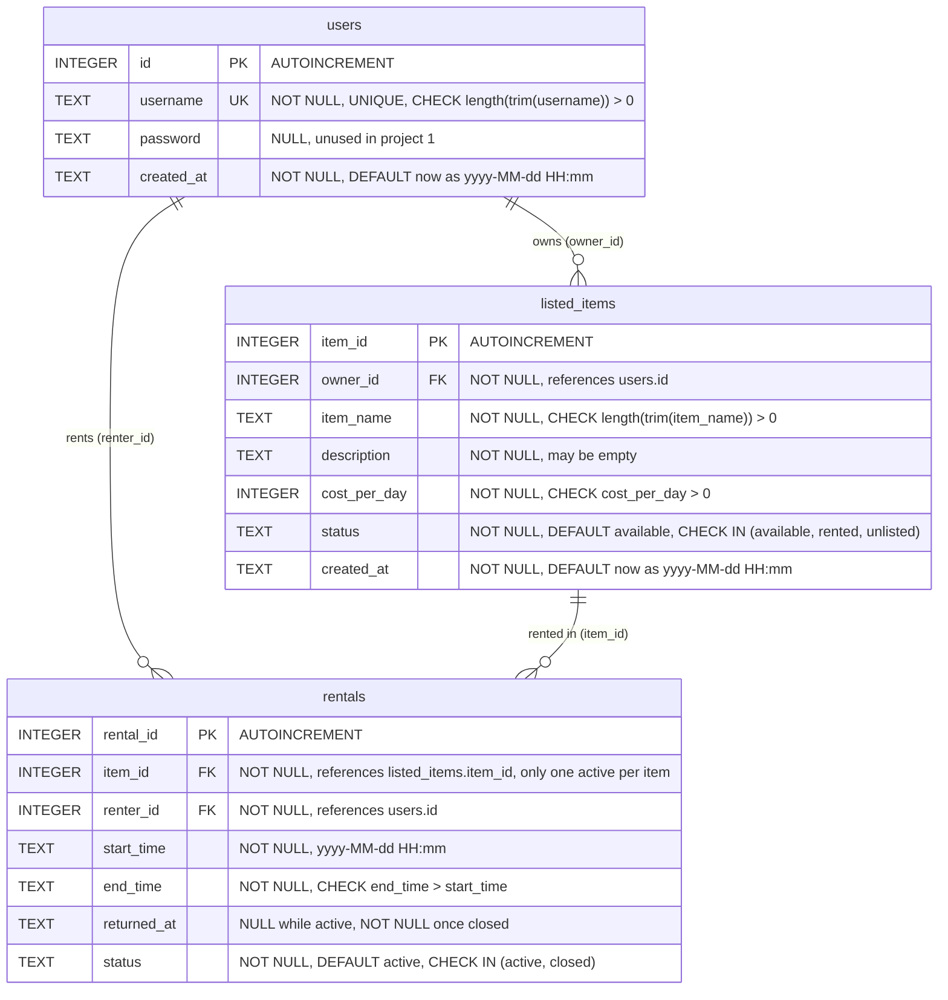

# Entity relationship diagram

## Relationships

| From | To | Cardinality | Meaning |
|---|---|---|---|
| `users.id` | `listed_items.owner_id` | one to many | A user owns zero or more items. Every item has exactly one owner. |
| `users.id` | `rentals.renter_id` | one to many | A user rents zero or more times. Every rental has exactly one renter. |
| `listed_items.item_id` | `rentals.item_id` | one to many | An item has zero or more rentals over time. Rentals are never deleted, so this is its history. |

`users` is referenced twice, as the owner of items and as the renter in rentals. The owner is the lowest-id user, and renters are created when a rental is recorded.

## Constraints that span columns or tables

| Table | Rule | Enforced by |
|---|---|---|
| `rentals` | `status = 'active'` requires `returned_at IS NULL`, and `status = 'closed'` requires `returned_at IS NOT NULL` | table-level `CHECK` |
| `rentals` | at most one `active` rental per item | partial unique index `index_one_active_rental_per_item` on `rentals(item_id) WHERE status = 'active'` |
| `rentals` | an item marked `rented` has exactly one active rental | service layer, in one transaction, because a `CHECK` cannot read another table |
| `listed_items` | allowed status moves (available to rented or unlisted, rented to available or unlisted, unlisted to available) | `ItemStatus` state machine in code |
| all | foreign keys are enforced | `PRAGMA foreign_keys = ON` on every connection |

There are no `ON DELETE` actions, because nothing is ever deleted. Items are removed softly through the `unlisted` status.